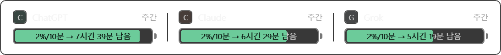
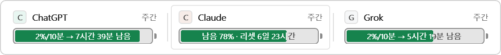

# Quotra WinUI 3 위젯 (`src/Quotra.WinUI`)

## 현재 UI — 2026-10-12 Fluent 개선

Desktop Acrylic 반투명 표면, Windows 한글 UI 글꼴인 맑은 고딕, 서비스 배지와 한도 종류,
24dip 무광 배터리, 120ms 셀 호버 강조로 상단 헤더를 재구성했습니다.
창 뒤에는 Desktop Acrylic 블러를 사용하며, 콘텐츠를 담는 루트와 패널은 투명합니다.
Acrylic을 지원하지 않거나 설정에서 끈 경우에는 테마에 맞는 불투명 표면으로 대체합니다.
브랜드 색은 작은 서비스 배지에, 잔여량 경고색은 배터리에만 적용합니다.

기본 카탈로그에는 ChatGPT(Codex)와 Claude가 있으며, Claude Code OAuth 로그인으로 주간·5시간 사용량도 자동 조회합니다.

배터리 안 예측 → 호버 시 잔여량·리셋 시간, 값이 없을 때 빈 문구, 트레이 메뉴,
고정/팝업 모드, 포커스를 가져오지 않는 표시, 조회·예측 엔진을 유지합니다.
색상 리소스는 Windows 고대비 테마의 시스템 색을 참조합니다.

`AppWindow.ResizeClient`와 XAML의 실제 측정 크기를 사용해 150% 배율에서 보이지 않는
Win32 프레임이 콘텐츠 높이를 깎던 문제를 해결했습니다.

`tools/verify-fluent.ps1`은 별도 카탈로그·표본을 생성하고 기존 예측/파서 검사와 UI 시나리오를 실행합니다.
`--capture=`는 실제 XAML의 PNG를 내보내며 투명 표면 상태와 셀/게이지 경계도 확인합니다.
캡처에는 DWM 모서리/그림자가 포함되지 않습니다. 데스크톱 자동화에서 도구 창이 검색되지 않아
실제 트레이 클릭·전역 단축키·고대비 OS 전환은 이번 검증에서 재현하지 못했습니다. 공개 릴리스 워크플로는 일반 사용자 권한에서 트레이 등록과 설치·업그레이드·제거를 별도로 확인합니다.
빌드 경고/오류 0개, 예측 27/27, 파서 32/32, UI 8종(다크·라이트·호버·단일·빈 상태·미연동·항상 위 해제·팝업)이 통과했습니다.
팝업은 실제 커서를 건드리지 않고 기존 커서 입력 하네스로 상단 흔들기 → 진입 → 이탈 → 숨김을 검증합니다.




아래는 이전 구현 및 과거 실측 기록입니다. 과거의 핀 버튼·크기 설명은 현재 UI에 적용되지 않습니다.

## 이전 구현 기록

이 저장소는 WinUI 3 위젯을 단일 앱으로 유지합니다.
WinUI 3 로 다음 5가지를 구현하고, 여기에 소모 추적/고갈 예측을 더했습니다.

| 요구 | 구현 | 확인한 증거 |
| --- | --- | --- |
| **Always On Top** — 다른 창 위에 작은 Quota 위젯 고정 | `AppWindow` 프리젠터 + `WS_EX_TOPMOST`, 위젯의 **유일한 버튼인 핀**으로 토글 | 다른 창(Discord)을 `SetWindowPos(HWND_TOP)` 로 끌어올린 뒤에도 Z 순서 **위젯 2 < Discord 5**. 핀 해제 시 `exstyle=0x8000180`(TOPMOST 비트 없음) |
| **Desktop Acrylic** — Win11 반투명 유리 | `SystemBackdrop = new DesktopAcrylicBackdrop()` + 틴트 브러시 알파 유지 | `DesktopAcrylicController.IsSupported()=True 적용=True`. 틴트 `#D91A1C25`(불투명하게 두면 유리가 죽는다) |
| **XAML 커스텀 게이지** — 배터리, 가로 채움, 등급 색 | `Controls/BatteryGauge.xaml` — 트랙(높이 26dip) + 왼쪽부터 차오르는 채움(별 칼럼 비율) + 오른쪽 단자 + **몸통 안 숫자** | 1곳 `290×72`(논리) 캡처에서 채움·단자·등급 색·안쪽 숫자 확인. 채움 경계가 글자를 가로지으면 두 벌을 경계에서 잘라 항상 읽힌다 |
| **Hover 로 값 공개** — 퍼센테이지·초기화까지 남은 시간 | 120ms 커서 폴링 → 셀 히트테스트(`TransformToVisual`) → 그 셀 배터리 안 문구만 교체(창 크기·배터리 높이 고정) | 로그 `hover: Claude → 남음 77% · 리셋 6일 23시간`, 창은 `702×72` 그대로. 벗어나면 `hover: 없음` |
| **다크/라이트 테마** — Windows 테마에 맞춤 | `ResourceDictionary.ThemeDictionaries` 3종 + 루트 `RequestedTheme` 런타임 전환, 시스템 감지(`AppsUseLightTheme`) | 시스템은 다크인 상태에서 `--theme=light` 로 강제 → 흰 배경/어두운 글자. 토큰 픽셀 검증: 새 `#61667A` **2905px** vs 이전 `#7B8090` 678px |
| **소모량 10분 추적 + 고갈 예측** | 10분마다 표본을 남기고, 최근 3시간의 최소제곱 기울기로 소모 속도와 고갈 시각을 낸다 | 자체 점검 **27/27**, 개발용 소스 120%/시간 → 측정 **20%/10분**(=120÷6, 오차 없음). 재시작 직후에도 저장된 이력으로 즉시 예측(2번째 표본부터 숫자) |
| **Codex 실연동** — 실제 남은 한도 | `src/Quotra.Shared/Providers/` 파서·클라이언트 + `Services/CodexUsageSource.cs` 어댑터 | `--provider-once=codex` → `status=Ok endpoint=…/backend-api/wham/usage` · `windows=[10080m:10%] plan=prolite` · 파서 점검 **32/32**. 실패 3종(무자격·네트워크·스키마)도 사유가 남는다 |
| **Claude 실연동** — 실제 구독 한도 | `Services/ClaudeUsageSource.cs` 에서 Claude Code OAuth 토큰을 읽고 5시간·주간 창 조회 | 기본 갱신 간격 60초. 토큰·응답 원문은 로그에 남기지 않음 |
| **확장 지점** (`IUsageSource`) | 카탈로그(무엇을 보일지)와 소스(얼마나 썼는지)를 분리. 소스가 없으면 `미연동` | 기본 카탈로그(ChatGPT·Claude 2곳)로 실값 수신 · 테스트 카탈로그 3곳 + 개발용 소스 → 배터리 채움·셀마다 고갈 시각 |

편의 기능으로 **트레이 아이콘 · 상단 엣지 좌우 흔들기 · Ctrl+Alt+F9** 도 제공합니다(요구 5가지에는 포함되지 않음).

## 화면 — 정보를 줄인 과정

처음에는 프로바이더마다 구체 게이지 + 링 + 물결 + 퍼센트를 그리고, 마우스를 올리면 아래로 상세 패널이
펼쳐졌습니다. 화면에 정보가 너무 많았고 정작 알고 싶은 **"얼마나 빨리 줄고 있나"** 가 묻혔습니다.
그래서 2026-10-12 에 이렇게 바꿨습니다.

    이전   지금  
| --- | --- | --- |
| 레이아웃 | 프로바이더를 세로 목록으로(드롭다운 상세 패널) | **가로로 나란히** — 배터리 바 한 줄 |
| 게이지 | 구체(`GaugeSphere`) — 링·액체·물결 | **배터리**(`BatteryGauge`) — 트랙(높이 26dip) + 채움 + 단자 |
| 늘 보이는 값 | 퍼센트·부제·소진 시각·표본 수·푸터 | **예측 감소량 하나**(`20%/10분 → 2시간 14분 남음`) — 배터리를 2배로 키우고 그 안에 넣어, 밖에 남는 줄이 없다 |
| 호버 | 창이 커지며 상세 패널 펼침 | 그 셀의 문구만 `남음 77% · 리셋 6일 23시간` 으로 교체(창 크기 고정) |
| 버튼 | 핀 + 닫기(✕) 두 개 | **핀 하나** — 숨기기는 트레이 메뉴 · `Ctrl+Alt+F9` · 상단 흔들기로 이미 세 갈래라, 화면에 ✕ 를 두면 실수로 꺼지는 자리만 생긴다 |

초기 구체 게이지 실험은 배터리 UI로 교체하면서 저장소에서 제거했습니다.

## 값의 출처 — 목업 제거와 확장 지점

2026-10-12, 앱에 있던 **목업 프로바이더 5곳과 난수 드리프트를 삭제**했습니다.
Codex 연동이 없는 상태에서 가짜 ChatGPT 수치를 띄우는 것은 거짓말이고, 그 값으로 계산한
소모 속도·고갈 예측도 함께 거짓이 되기 때문입니다. 대신 **확장 지점만** 남겼고,
같은 날 **Codex 실연동을 붙여** 기본 카탈로그가 `[]` 에서 시작했고, 현재는 Claude도 포함합니다.

| 계층 | 역할 | 파일 |
| --- | --- | --- |
| 카탈로그 | 무엇을 보여줄지(이름·색·한도 창 라벨) | `Data/providers.json`(기본 ChatGPT·Claude 2곳) · `providers.example.json`(형식 예시) |
| 소스 | 얼마나 썼는지 | `Services/IUsageSource.cs` — `ProviderSnapshot FetchAsync()` |
| 실연동 소스 | Codex(ChatGPT 플랜) · Claude | `Services/CodexUsageSource.cs` + `Services/ClaudeUsageSource.cs` · Codex 파서·클라이언트는 `src/Quotra.Shared/Providers/` |
| 연결 | id 로 소스 등록 + 주기 갱신 | `Services/UsageService.cs` · `App.xaml.cs` |

**값 없음(null)과 0을 구분하는 것이 이 설계의 핵심입니다.**

| 상태 | 모델 | 화면 |
| --- | --- | --- |
| 소스 없음 | `Primary = null`, `IsLinked = false` | 빈 배터리 · 셀 아래 `미연동` |
| 소스 있고 조회 실패 | `Primary = null`, `Error != null` | 빈 배터리 · `조회 오류` |
| 소스 있고 값 수신 | `Primary = 0.37` | 배터리 63% 채움 · `20%/10분 → 2시간 14분 남음`, 호버 시 `남음 63% · 리셋 6일 23시간` |

`UsageSampler` 도 `null` 인 값은 **표본으로 남기지 않습니다** — 0 으로 기록하면 예측이 0% 에서
출발해 조용히 틀립니다. 그래서 미연동 상태의 로그는 `sample: 표본 0개 · 연동된 값 없음(미연동)` 한 줄입니다.

붙이는 방법·Codex와 Claude 실연동 상세(엔드포인트·파서 규칙·실패 경로)·계약 규칙은 **[providers.md](providers.md)** 에 따로 정리했습니다.
`SimulatedUsageSource`(`--simulate=`)는 "구현할 메서드가 둘뿐"이라는 것을 보여주는 최소 예시이자 검증 하네스입니다.

## 소모량 기록과 고갈 예측 (10분 간격)

"지금 몇 % 남았나"만으로는 부족합니다. 같은 20%라도 1시간 뒤 바닥날 수도, 3일 뒤 바닥날 수도 있습니다.
그래서 **시각이 붙은 표본**을 남기고 기울기를 계산합니다.

```
10분마다 → history.Record(프로바이더, 창, 사용률)
최근 3시간 표본 → 마지막 리셋 이후만 남김 → 최소제곱 기울기(시간당)
                → 표본 2개 + 10분 폭이 안 되면 "측정 중"(두 번째 표본에서 숫자가 나온다)
                → 고갈 = 남은 양 ÷ 속도, 리셋이 더 앞서면 "리셋 먼저"
```

계산 코드는 **`src/Quotra.Shared/Forecast/`** 에 있습니다(UI 의존 없이 WinUI 프로젝트에서 직접 링크합니다).

| 파일 | 역할 |
| --- | --- |
| `UsagePoint.cs` | 시각 + 사용률 표본 한 점, 한도 창 구분(Primary/Secondary) |
| `UsageHistory.cs` | 시리즈별 표본 저장(7일 보관) + JSON 영속화(임시 파일 교체로 깨짐 방지) |
| `DepletionForecast.cs` | 기울기·고갈 시각 계산과 문구화(`ForecastText`) |
| `ForecastSelfTest.cs` | 합성 시계열 27케이스 자체 점검 |
| `Providers/CodexUsageParser.cs` | Codex 응답 파서 — 이름 대신 창 길이로 주간/세션을 가른다 |
| `Providers/CodexUsageClient.cs` | auth.json 읽기(읽기만) + 후보 경로 폴백 + 실패 분류 |
| `Providers/CodexSelfTest.cs` | 합성 응답 32케이스 자체 점검 |

**설계 판단 네 가지**

1. **리셋 절단** — 한도가 리셋되면 사용률이 뚝 떨어집니다. 그 이전 표본을 섞으면 속도가 왜곡되므로 마지막 리셋 이후만 씁니다.
   (자체 점검: 리셋 전 80%/시간 소모 + 리셋 후 6%/시간 → **6%/시간**으로 측정 ✓)
2. **최소제곱 기울기** — 처음·끝 두 점만 빼면 잡음에 그대로 흔들립니다. 교대 잡음(±0.5%)을 섞어도 3%/시간을 유지하는지 검증합니다.
3. **관측 폭 하한 = 표본 간격(10분)** — 10분 간격이면 **두 번째 표본**에 첫 예측이 나옵니다. 폭 하한이 없으면 1~2분 사이의 우연한 차이를 속도로 오인합니다.
   앱이 꺼져 있던 구간은 **기록하지 않습니다** — 없던 시간을 지어내면 예측이 조용히 틀어집니다.
4. **긴 공백은 시간축에서도 절단** — 기록을 안 남기는 것만으로는 부족했습니다. 표본 사이가 그 시리즈의
   **간격 중간값**의 4배를 넘으면 리셋과 똑같이 끊습니다. 이 처리가 없던 동안 재시작이 끼면 기울기의 **분모만 커져**
   속도가 실제보다 낮게 나왔습니다(실측: 주입 20%/10분인데 25초 공백 뒤 **0.8%/10분**).
   같은 데이터가 지금은 **20.0%/10분** 으로 복원됩니다(자체 점검 "긴 공백 뒤 재시작").

**화면**

| 위치 | 내용 |
| --- | --- |
| 배터리 안(평소) | `20%/10분 → 2시간 14분 남음` — 예측 감소량과 고갈까지 남은 시간. 24시간 이상이면 `1일 3시간 남음`처럼 표시한다 |
| 배터리 안(호버) | `남음 77% · 리셋 6일 23시간` — 퍼센테이지와 초기화까지 남은 시간(그 셀의 문구만 바뀐다) |
| 배터리 | 채움 = 남은 비율, 색 = 등급(정상 `#6EE7B7` / 주의 `#FFC86B` / 위험 `#FF7A8A`), 테두리 = 브랜드 색. 몸통 26dip(2배) |
| 배터리 안 숫자 | 채움 경계가 글자를 가로지므로 **두 벌을 겹쳐 경계에서 자른다** — 채움 위는 어두운 글자, 트랙 위는 보조 글자 |

상태가 갈래로 나뉩니다: `측정 중`(표본 부족) · `소모 없음`(거의 안 줄어듦, 한도 회복 포함) · `0.4%/10분 → 3시간 40분 남음`(고갈 예상) · `리셋 먼저` · `여유`(7일 초과) · `소진됨`.
값이 없으면 이 자리에 예측 대신 `미연동` / `조회 오류` 가 들어갑니다 — 없는 값으로 만든 예측은 없습니다.

### 실측 (표본을 남길 때마다 남는 로그 한 줄)

```
sample: 표본 240개 · 3곳 기록 · 값 있는 곳 3/3곳 · 대표 Grok: 20%/10분 소모 · 소진 예상 01:57 (약 31분) ·
        고갈 예상 3곳: ChatGPT 20%/10분 → 02:11, Claude 20%/10분 → 02:04, Grok 20%/10분 → 01:57   ← 개발용 3곳
sample: 표본 8개 · 1곳 기록 · 값 있는 곳 1/1곳 · 대표 ChatGPT: 0.67%/10분 소모 · 소진 예상 내일 00:42 (약 20시간) ·
        고갈 예상 1곳: ChatGPT 0.67%/10분 → 내일 00:42                                             ← 실연동(Codex 주간 한도)
sample: 표본 0개 · 연동된 값 없음(미연동)                                                          ← 값이 하나도 없을 때
```

| 항목 | 결과 |
| --- | --- |
| 엔진 자체 점검 | **27/27 통과**(꾸준한 소모·리셋 절단·긴 공백 절단·잡음 내성·표본 1개·표본 2개부터 예측·1분 폭 무시·느린 소모 문구·소모 없음 문구·이미 소진·리셋 우선·고갈이 먼 경우·한도 회복·잡음으로 내려간 기울기·재시작 표본 혼입) |
| Codex 파서 점검 | **32/32 통과** — 실측 응답 형태·창 두 개(순서 뒤집힘)·0~1 스케일·다른 필드명·에포크 리셋·세션만·상한·창 길이 없음·JSON 아님·이름이 바뀐 응답 |
| Codex 실연동 | `--provider-once=codex` → `status=Ok endpoint=https://chatgpt.com/backend-api/wham/usage` · `windows=[10080m:10%] plan=prolite` · 주간 10% 사용 / 리셋 159시간 뒤 · 세션 창 없음 |
| Codex 경로 폴백 | `/api/codex/usage` → **403** → `/backend-api/wham/usage` → **200** (폴백이 실제로 쓰인다) |
| Codex 실패 경로 | 도달 불가 호스트 → `NetworkError` · 없는 자격증명 → `NoCredential` · 깨진 JSON → `SchemaChanged` — 셋 다 사유가 로그에 남고 종료 코드 0 |
| 위젯(실연동 1곳) | 논리 `290×72` · 물리 `(1703,21)-(2138,129)` = 435×108 px · 호버 문구 `남음 84% · 리셋 6일 13시간` |
| 속도 정확도 | 주입 120%/시간(=20%/10분) → 측정 **20%/10분**(난수 없는 소스라 오차 0) |
| 값 없음 | 빈 카탈로그(`tools\fixtures\empty-providers.json`) → `프로바이더 0곳` · `표본 0개` · 빈 배터리 · `프로바이더 없음` 안내 |
| 확장 지점 | `--catalog=tools\fixtures\test-providers.json --simulate=120` → 3곳 값 수신·배터리 채움·셀마다 예측 |
| 호버 | `hover: ChatGPT → 남음 84% · 리셋 6일 13시간`, 창 크기 `290×72` 유지 · 밖으로 나가면 `hover: 없음` |
| 호버 로그 | 값이 늦게 도착하면 같은 셀이라도 문구가 바뀔 때 다시 남는다 — `hover: ChatGPT → 값 없음` 다음 줄에 실제 문구 |
| 기본 간격 | 오버라이드 없이 실행 시 로그에 `간격 10분` · 첫 표본은 값이 들어오는 즉시(`5초 간격으로 재시도`) |
| 첫 예측 시점 | 표본 2개 + 10분 폭이면 숫자가 나온다(10분 간격 운용에서 **두 번째 표본**) — 예전엔 3개/20분을 요구해 30분 동안 `측정 중`이었다 |

캡처: `docs/winui-codex.png`(실연동 1곳) · `docs/winui-codex-hover.png`(호버) · `docs/winui-codex-light.png`(라이트) ·
`docs/winui-off-pin.png`(고정 해제) · `docs/winui-unlinked.png`(프로바이더 0곳) ·
`docs/winui-dark.png` / `docs/winui-hover.png`(개발용 소스 3곳 배치)


## 실행

```powershell
dotnet build src\Quotra.WinUI\Quotra.WinUI.csproj -c Release
src\Quotra.WinUI\bin\x64\Release\net10.0-windows10.0.22000.0\win-x64\QuotraWinUI.exe
```

- 자기 포함 배포(`WindowsAppSDKSelfContained=true`, `WindowsPackageType=None`) — **Windows App Runtime 설치가 필요 없습니다.**
- 이 프로젝트가 솔루션(`Quotra.sln`)의 유일한 앱 구성원입니다.
- 기본 카탈로그에는 **ChatGPT와 Claude**가 들어 있습니다. Codex는 `%USERPROFILE%\.codex\auth.json`, Claude는 `%USERPROFILE%\.claude\.credentials.json` 로그인이 필요합니다.
  로그인 전이거나 다른 프로바이더를 붙이려면 [providers.md](providers.md) 를 보세요.

### 검증용 명령줄 스위치

| 스위치 | 뜻 |
| --- | --- |
| `--simpath=x,y@ms;...` | 커서를 스크립트대로 움직인다(실제 마우스를 건드리지 않음). 셀 호버 자동 검증에 씀 |
| `--theme=auto\ light\ dark` | 테마 강제 |
| `--ontop=true\ false` | 항상 위 고정을 강제로 켜고 끔 |
| `--catalog=path` | 다른 프로바이더 정의 파일(기본 `Data\providers.json`) |
| `--simulate=percentPerHour` | 개발용 소스를 모든 프로바이더에 붙인다(난수 없음). 확장 지점·예측 검증용 |
| `--refresh=ms` | 소스 갱신 주기(기본 60000) |
| `--sample-interval=ms` | 소모 표본 간격(기본 10분). 10분을 기다리지 않고 예측을 검증할 때 |
| `--sample-span=minutes` | 예측에 쓰는 관측 최소 폭(기본 10분) |
| `--history=path` | 이력 파일 위치(기본 `%LOCALAPPDATA%\Quotra\usage-history.json`) |
| `--forecast-test` | 예측 엔진 자체 점검만 하고 종료(실패 시 종료 코드 1) |
| `--provider-test=id` | 프로바이더 소스 자체 점검만 하고 종료(실패 시 종료 코드 1) |
| `--provider-once=id` | 프로바이더 1회 조회 후 결과만 로그로 남기고 종료 |
| `--codex-parse=path` | 저장해 둔 응답으로 파서만 검증 |
| `--provider-url=id=url` · `--provider-file=id=path` | 조회 주소·자격증명 경로 강제(실패 경로 검증용 · 진단 주소는 로컬 루프백만) |
| `--exit-after=ms` | 지정 시간 뒤 스스로 종료(캡처 자동화) |

```powershell
$repo = (Get-Location).Path
$exe = 'src\Quotra.WinUI\bin\x64\Release\net10.0-windows10.0.22000.0\win-x64\QuotraWinUI.exe'

# 실연동 캡처(이전 캡처 시점의 기본 카탈로그 = Codex 1곳)
Start-Process $exe -WorkingDirectory (Split-Path $exe) -ArgumentList '--refresh=5000','--sample-interval=1000',
  '--sample-span=0.2',"--history=$repo\tools\fixtures\history-codex.json",'--theme=dark','--exit-after=30000'
Start-Sleep -Seconds 24 ; .\tools\window-shot.ps1 -Out docs\winui-codex.png

# 셀 호버 캡처: 커서를 첫 셀 가운데로(창이 화면 중앙 정렬이라 left=1703, 셀 중심 ≈ 1900)
Start-Process $exe -WorkingDirectory (Split-Path $exe) -ArgumentList '--simpath=1900,60@4000','--exit-after=26000'
Start-Sleep -Seconds 24 ; .\tools\window-shot.ps1 -Out docs\winui-codex-hover.png

# 프로바이더 0곳 캡처(빈 카탈로그)
Start-Process $exe -WorkingDirectory (Split-Path $exe) -ArgumentList "--catalog=$repo\tools\fixtures\empty-providers.json",'--exit-after=8000'
.\tools\window-shot.ps1 -Out docs\winui-unlinked.png

# 3곳 배치 + 개발용 소스 캡처(호버는 Claude 셀 가운데 = 1839)
Start-Process $exe -WorkingDirectory (Split-Path $exe) -ArgumentList "--catalog=$repo\tools\fixtures\test-providers.json",
  '--simulate=120','--refresh=1000','--sample-interval=1000','--sample-span=0.2',
  "--history=$repo\tools\fixtures\history-battery.json",'--simpath=400,900@0;1839,85@20000','--exit-after=34000'
Start-Sleep -Seconds 19 ; .\tools\window-shot.ps1 -Out docs\winui-dark.png
Start-Sleep -Seconds 9  ; .\tools\window-shot.ps1 -Out docs\winui-hover.png

# 자체 점검 두 가지(창을 만들지 않는다)
Start-Process $exe -WorkingDirectory (Split-Path $exe) -ArgumentList '--forecast-test'          -Wait -RedirectStandardOutput ft.log
Start-Process $exe -WorkingDirectory (Split-Path $exe) -ArgumentList '--provider-test=codex'    -Wait -RedirectStandardOutput ct.log
Start-Process $exe -WorkingDirectory (Split-Path $exe) -ArgumentList '--provider-once=codex'    -Wait -RedirectStandardOutput co.log
```

> 캡처가 흐리면 창이 아직 그려지지 않은 것이다. WinUI 창은 GDI 화면 캡처에 잡히지 않으므로
> `window-shot.ps1` 이 `PrintWindow(PW_RENDERFULLCONTENT)` 로 창 자신을 그린다.

## 구조

```
src/Quotra.WinUI/
├─ App.xaml(.cs)              진입점, 설정→카탈로그→소스 등록→창→트레이→엣지 감지 배선, 명령줄 스위치
├─ app.manifest               PerMonitorV2, supportedOS(Win10/11)
├─ Data/providers.json        프로바이더 정의(기본 = ChatGPT + Claude) · providers.example.json(형식 예시)
├─ Log.cs                     %LOCALAPPDATA% 실패 시 %TEMP% 로 내려가는 로그 + 부팅 표식
├─ Interop/                   Native, ScreenInfo, CursorProbe, EdgeWatcher, SystemMessageSink, ClaudeDesktopSessionReader
├─ Controls/BatteryGauge.xaml  가로 배터리(트랙 26dip + 왼쪽부터 채움 + 단자, 몸통 안 숫자는 두 벌을 경계에서 클립)
├─ Views/WidgetWindow.xaml     가로 배터리 바 · 셀별 호버 · 크롬 설정 · 테마 적용
├─ Themes/Theme.xaml          ThemeDictionaries(Dark/Light/HighContrast) + 컨트롤 스타일
├─ Themes/Palette.cs          테마 무관 색(브랜드·등급) 단일 출처
├─ Models/ProviderUsage.cs    테마 의존 없는 모델(값이 없으면 null — 0 과 구분)
└─ Services/                  UsageService(카탈로그+소스), IUsageSource(확장 지점), UsageSampler(10분 표본),
│                             CodexUsageSource · ClaudeUsageSource(실연동 어댑터),
                              SimulatedUsageSource(개발용 예시), WidgetSettings, SystemTheme

src/Quotra.Shared/Forecast/   예측 엔진(UI 무관, WinUI csproj 가 링크해 씀)
src/Quotra.Shared/Providers/  Codex 파서·클라이언트·자체 점검(UI 타입 없음 → 같은 방식으로 공유 가능)

docs/providers.md             프로바이더를 붙이는 방법 + Codex·Claude 실연동 상세(엔드포인트·파서·실패 경로)
```

UI는 WinUI에 맞춰 구현하고, 예측·프로바이더 파싱은 `src/Quotra.Shared/`에 둬 UI 색상 타입과 분리합니다.


## 테마 토큰

라이트/다크 값은 `Theme.xaml` 의 `ThemeDictionaries` 안에만 있고, 나머지 XAML 은 `{ThemeResource ...}` 로 참조합니다. 그래서 루트의 `RequestedTheme` 만 바꾸면 색이 통째로 따라옵니다.

주의할 점 두 가지를 실제로 겪었습니다.

1. **Brush 속성에는 Color 가 아니라 Brush 를 넘겨야 합니다.** 초기 UI 이식 과정에서 `Color` 를 `Background` 에 넣어 `XamlParseException` 이 났습니다.
2. **코드에서 만든 `TextBlock` 에 `Foreground` 를 직접 지정하면 테마 전환이 안 따라옵니다.** `Style` 안의 `{ThemeResource}` 는 각 요소의 실제 테마로 해석되므로 `RowTitleTextStyle`/`RowMetaTextStyle` 로 넘겼습니다.

## 검증 결과 (실측)

```
설정: alwaysOnTop=True theme=Auto acrylic=True
widget exstyle=0x8000188 noactivate=True toolwindow=True topmost=True
widget backdrop: DesktopAcrylicController.IsSupported()=True 적용=True
widget: 셀 3개 · 폭 702dip · 높이 72dip · 표본 간격 10분
widget place: 요청=(1367,21) 1107x129 실제=(1367,21)-(2474,150) monitor=(0,0)-(3840,2160) dpi=144 scale=1.5
widget show: 포커스 유지=True (0x70394 → 0x70394)     ← 창을 띄워도 작업 중인 창이 포커스를 잃지 않음
tray: NIM_ADD → True (Win32 0, cbSize=976)
tray icon 위치=(3465,2167) 크기=48x51                 ← 셸이 실제로 자리를 잡아줌
hover: 없음                                          ← 커서가 밖 → 전 셀이 예측 감소량
hover: Claude → 남음 77% · 리셋 6일 23시간            ← 셀에 올림. 창 크기는 그대로
```

| 항목 | 결과 |
| --- | --- |
| 창 배치(실연동 1곳) | 논리 `290×72` → 물리 (1703,21)-(2138,129) = 요청값과 **정확히 일치**(DPI 144, 배율 1.5) |
| 창 배치(3곳) | 논리 `702×72` → 물리 (1394,21)-(2447,129) |
| 포커스 | `0x70394 → 0x70394` — `WS_EX_NOACTIVATE` + `SW_SHOWNOACTIVATE`, `Activate()` 호출 없음 |
| 항상 위 | 위젯 Z=2, Discord Z=5 (Discord 를 최상단으로 올린 뒤 측정) |
| 핀 해제 | `exstyle=0x8000180`(TOPMOST 없음), `presenter=False` |
| 호버 | 셀 히트테스트로 그 셀 배터리 안 문구만 교체. 창 리사이즈 없음(`290×72` 유지), 이탈 시 `hover: 없음` |
| 테마 | 다크/라이트 캡처 + 보조 텍스트 토큰 픽셀 일치 2905px |
| 트레이 | `Shell_NotifyIconGetRect` 가 화면 좌표 반환 = 표시 중 |
| 값 없음 | 빈 카탈로그(`tools\fixtures\empty-providers.json`)에서 `프로바이더 0곳` · 빈 배터리 · `sample: 표본 0개 · 연동된 값 없음(미연동)` |

캡처: `docs/winui-codex.png`(실연동 1곳) · `docs/winui-codex-hover.png` · `docs/winui-codex-light.png` ·
`docs/winui-off-pin.png` · `docs/winui-unlinked.png`(0곳) ·
`docs/winui-dark.png` / `docs/winui-hover.png` / `docs/winui-light.png`(개발용 소스 3곳: 다크 · 호버 · 라이트)

## 이 환경에서 겪은 함정 (다시 만나면 시간 아끼라고 남깁니다)

1. **WinUI 3 창은 GDI 화면 캡처에 안 잡힙니다.** `WS_EX_NOREDIRECTIONBITMAP` 로 만들어져서 `CopyFromScreen`/`BitBlt` 에는 창 **뒤에 있는 내용**이 찍힙니다("위젯이 안 그려진다"고 오진하기 딱 좋습니다). `tools/window-shot.ps1` 처럼 `PrintWindow(PW_RENDERFULLCONTENT)` 로 창 자신을 그려야 합니다.
2. **XAML 로드 실패는 스토우드 예외(`0xc000027b`)로 죽어서 메시지가 사라집니다.** `try/catch` 로도 안 잡히는 fail-fast 가 있어, `App` 생성자에서 단계별 로그를 남기고 `Log` 는 stdout 으로도 내보내게 했습니다.
3. **로그 폴더 권한이 막히면 로그가 "아무것도 안 남는" 형태로 나타납니다.** `%LOCALAPPDATA%\Quotra` 가 읽기 전용 토큰으로 실행될 때 `UnauthorizedAccessException` 이 조용히 삼켜져 "관리 코드가 실행되지 않았다"로 오진했습니다. `Log` 는 `%TEMP%` 로 폴백하고, 실패를 다시 로깅하지 않습니다(첫 시도에서 무한 재귀 → 스택 오버플로를 겪었습니다).
4. **Low 무결성 환경에서는 트레이 아이콘 등록이 거부될 수 있습니다.** 현재 Codex 실행 환경에서는 실행 파일이 Low 무결성이고 `Shell_NotifyIcon` 이 Win32 오류 5(액세스 거부)로 실패했습니다. 공개 릴리스 워크플로는 일반 사용자 권한의 Windows 러너에서 트레이 등록을 통과해야 게시 단계로 진행합니다.
5. **XAML `CornerRadius` 는 DWM 라운드와 맞춰야 합니다.** DWM `DWMWCP_ROUND` 는 8px 이므로 패널도 `CornerRadius=8` 로 두었습니다. 다르면 유리가 모서리 밖으로 번집니다.

## 이식성 메모

- `UIElement.Clip` 은 `RectangleGeometry` 만 받습니다 → 원형 클립은 `Border.CornerRadius` 로 처리했습니다(배터리는 클립이 필요 없어 비율을 별 칼럼 폭으로 넘깁니다).
- `Trigger`/`DataTrigger` 가 없어 상태는 `VisualStateManager` 로, `OnRender` 가 없어 도형은 XAML `Path`/`Shape` 로 그렸습니다.
- `DesktopAcrylicController.IsSupported()` 가 능력 질의 지점입니다(`DesktopAcrylicBackdrop.IsSupported()` 는 없습니다).
- `AppWindow.MoveAndResize(RectInt32)` 는 **물리 픽셀**입니다(DIP 아님).
